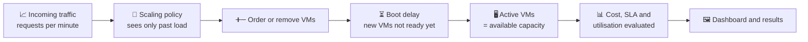
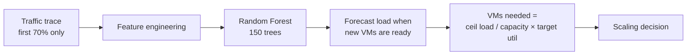
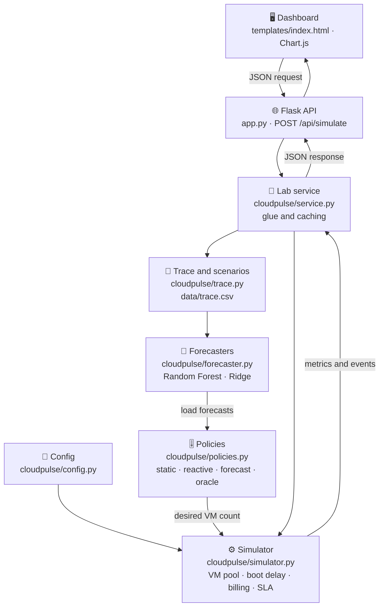
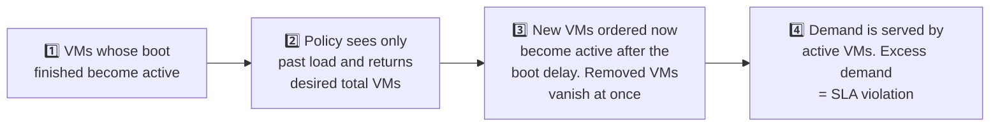

<div align="center">

# ☁️ CloudPulse

### Intelligent Cloud Auto-Scaling Simulation and Workload Forecasting Platform

*Watch a cloud scale up and down in real time, and find out when prediction actually beats simple rules.*


**Cloud Computing (7th semester) academic project**

[Overview](#-project-overview) · [Features](#-key-features) · [Architecture](#-system-architecture) · [Installation](#%EF%B8%8F-installation) · [Results](#-experimental-results) · [Limitations](#%EF%B8%8F-limitations)

</div>

---

## 📌 Project Overview

**CloudPulse** is an interactive cloud auto-scaling simulator. It replays a web-traffic trace through a small model of a cloud (a pool of Virtual Machines, a boot delay, billing and an SLA check) and compares **six scaling policies** on the same traffic, so you can see the trade-off between cost and performance.

When traffic rises, a system may need more Virtual Machines (VMs). When traffic falls, extra VMs only waste money. CloudPulse shows how different "managers" handle this, including one that uses a **Random Forest** forecast to order VMs *before* the traffic arrives.

> [!IMPORTANT]
> CloudPulse is a **simulation and educational platform**. It does **not** create or manage any real cloud infrastructure, and all costs and response times are simulated.

---

## 🎯 Problem Statement

Cloud applications face constantly changing demand. For example, an online shop may see steady traffic on a normal day and a sudden spike during a sale.

| Problem | What happens |
|---|---|
| 🔻 **Too few VMs** | The system is overloaded, users are slowed down or turned away, and the SLA is violated. |
| 🔺 **Too many VMs** | Servers sit idle and money is wasted. |
| ⏳ **VMs are not instant** | New VMs take time to boot, so a policy that reacts *after* a spike arrives late. |

CloudPulse simulates these situations and measures how well each policy copes.

---

## 💡 Core Idea



> **Traffic changes → a policy decides how many VMs it wants → VMs are added or removed (new ones after a boot delay) → performance and cost are measured.**

---

## 🚀 Key Features

### 🎭 Four Workload Scenarios

Each scenario modifies only the **test period** of the trace, so the forecaster never trains on the changed data.

| Scenario | What it does |
|---|---|
| 🌊 **Normal** | The test period is replayed unchanged. |
| ⚡ **Flash crowd** | Four sudden spikes of up to 2.5× traffic, never seen in training. |
| 📈 **Steady growth** | Traffic grows from 1.0× to 1.8× over the test period, beyond the training range. |
| 〰️ **Noisy** | Heavy random noise (roughly ±25%) on top of the test period. |

A **traffic level** slider (×0.5 to ×2.0 in the dashboard) scales the test-period load further.

### 🧠 Six Scaling Policies

| Policy | Idea |
|---|---|
| 🔒 **Static** | A fixed fleet sized for the 95th-percentile load of the training period. Safe but wasteful. |
| 🎚️ **Reactive threshold** | Scales out above 80% utilisation and scales in below 40%, with a cooldown. The classic rule-based approach. |
| 🔁 **Forecast: last value** | Sizes the fleet for the most recent load value (a naive forecast). |
| 📉 **Forecast: moving average** | Sizes the fleet for the average of the last three intervals. |
| 🌲 **Forecast: Random Forest (ML)** | Sizes the fleet for an ML forecast of the load at the moment new VMs become ready. |
| 👁️ **Oracle** | Knows the future load. An idealised **benchmark**, not a real policy. |

The dashboard offers four managers (Fixed fleet, Rule-based, AI predictor, Perfect foresight). The naive and moving-average policies appear in the **Technical details** tables on the Results page.

> No policy is assumed to win. The comparison is a **cost vs. performance trade-off**, and the results below show that ML does not always come out ahead.

### 🖥️ Interactive Live Dashboard

A single-page web dashboard with four views: **Home**, **Simulate**, **Results** and **Guide**.

```text
 Visitors per minute
        │
        ▼
 ┌───────────────┐
 │ Load balancer │   (visual representation: shares visitors fairly)
 └───────┬───────┘
         ▼
 ┌──────┬──────┬──────┬──────┐
 │ VM 1 │ VM 2 │ VM 3 │ ⏻ VM │   ← running VMs and VMs still starting up
 └──────┴──────┴──────┴──────┘
         ▼
 Capacity, speed, cost and overload meters
```

The Simulate view includes:

- ▶️ Play / pause, three playback speeds, a timeline scrubber and a **Jump to busiest moment** button
- 🖥️ A live grid of running and starting VMs
- 📊 Six live meters: visitors per minute, how busy the computers are, page speed, computers running, money spent and time overloaded
- 💬 A plain-language status line (calm, busy, getting crowded, overloaded)
- 🗒️ An event list of what the manager just did
- 🏁 A scoreboard comparing the four managers on money spent and time overloaded

The Results view contains the full metric table for all six policies, the forecast-accuracy table, and editable settings (capacity per VM, target utilisation, price per VM-hour).

### 🔵 Workload vs 🩷 Capacity Graph

The main chart (Chart.js) plots:

- 🔵 **Visitors**: the incoming workload (blue area)
- 🩷 **What the computers can handle**: capacity of the active VMs (pink stepped line)

```text
Blue ≤ Pink  →  ✅ enough capacity
Blue > Pink  →  ⚠️ demand exceeds capacity, so some load is unserved
```

### ⏳ VM Startup Delay

New VMs are not available immediately. You can choose a boot time of **Instant, 5, 10, 20 or 30 minutes** (0, 1, 2, 4 or 6 simulation steps). VMs that are still booting are **already billed**, as on real clouds. During the delay, overload can still happen. This is the central challenge that predictive scaling tries to address.

### 🗒️ Scaling Event Tracking

The simulator records three kinds of events, shown in the dashboard's event list:

```text
➕ Ordered N new computers
✅ N computers are ready and sharing traffic
➖ Switched off N computers to save money
```

---

## 📈 Metrics

All metrics are computed on the **test period** only.

| Metric | Meaning |
|---|---|
| **SLA violation %** | Share of intervals where demand exceeded active capacity. |
| **Unserved %** | Share of total demand that could not be served. |
| **VM-hours** | Total VM time billed, including VMs that are still booting. |
| **Cost (USD)** | VM-hours × price per VM-hour (default $0.05). **Simulated, not real billing.** |
| **Avg utilisation %** | Average of demand ÷ capacity, capped at 100% per interval. |
| **Scaling actions** | Number of intervals in which VMs were ordered or removed. |
| **Avg / p95 response (ms)** | A simple queueing-style **estimate** that grows as VMs fill up. It is **not** measured latency. |

---

## 🤖 Machine Learning Component

CloudPulse uses a **Random Forest Regressor** (scikit-learn) to forecast the load at the moment newly ordered VMs would become ready (`load[t + boot_steps]`).



**Features** (built only from past values, plus clock features of the *target* time, which are known in advance):

- 12 lagged load values
- 3-step and 12-step moving averages
- a short-term trend (`lag0 − lag3`)
- time of day (sin and cos) and a weekend flag

**Training** uses a strict time split: the first **70%** of the trace trains the model and the last **30%** is the test period. A unit test checks that no training target touches the test period.

### 📉 Forecast Evaluation

Forecasting accuracy is reported on the test segment as **MAE**, **RMSE** and **R²** for four forecasters:

| Forecaster | Role |
|---|---|
| Last value (naive) | Baseline |
| Moving average (3) | Baseline |
| Ridge regression | Extra comparison model (evaluation only) |
| Random Forest | The ML model used by the scaling policy |

> These metrics judge the **forecasting model**. They are separate from the cloud-system metrics above. Because load is strongly autocorrelated, R² is high even for the naive forecast, so always compare against the baselines.

---

## 🏗️ System Architecture



### ⏱️ Simulator Timeline (every 5-minute interval)



Key simulation rules, taken directly from the code:

- A policy only ever sees **past** load (the Oracle is the deliberate exception).
- When scaling in, VMs that are still booting are cancelled first (newest first).
- The fleet is kept between **2** and **200** VMs.
- A **cooldown of 3 intervals** separates a scale-out from a following scale-in.

### 🔧 Default Simulation Parameters

Every value below is an **assumption** (see `cloudpulse/config.py`).

| Parameter | Default |
|---|---|
| Capacity per VM | 100 requests/min |
| Boot delay | 2 intervals (10 min) |
| Interval length | 5 min |
| Price | $0.05 per VM-hour (billed while booting or running) |
| Min / max VMs | 2 / 200 |
| Target utilisation | 0.75 |
| Cooldown | 3 intervals |

---

## 🛠️ Technology Stack

| Layer | Technology |
|---|---|
| **Backend** | Python 3.10+, Flask (≥ 3.0), Gunicorn (for deployment) |
| **Machine Learning** | scikit-learn (Random Forest, Ridge, metrics), pandas, NumPy |
| **Frontend** | HTML5, CSS3, vanilla JavaScript (single template, inline SVG icons) |
| **Visualisation** | Chart.js 4.4.1 (loaded from the jsDelivr CDN) |
| **Testing** | Python `unittest` |
| **Deployment (optional)** | Google App Engine Standard (`app.yaml`, Python 3.11) |

---

## 📁 Project Structure

```text
cloudpulse/
│
├── app.py                    # Flask app: dashboard + REST API
├── app.yaml                  # Google App Engine config (optional deployment)
├── requirements.txt
├── README.md
│
├── cloudpulse/               # Core package
│   ├── config.py             # Simulation parameters (SimConfig)
│   ├── trace.py              # Synthetic trace generator, CSV loader, scenarios
│   ├── forecaster.py         # Feature engineering, Random Forest, Ridge, evaluation
│   ├── policies.py           # Static, reactive, forecast-based and oracle policies
│   ├── simulator.py          # Discrete-time VM pool simulator and metrics
│   └── service.py            # Glue layer: trains forecasters (cached), runs all policies
│
├── templates/
│   └── index.html            # Dashboard (Home, Simulate, Results, Guide)
│
├── data/
│   └── trace.csv             # Synthetic 14-day workload trace
│
├── scripts/
│   ├── run_experiments.py    # Headless experiment runner, writes results/*.csv
│   └── prepare_nasa.py       # Converts a NASA HTTP access log into trace.csv
│
├── results/
│   ├── policy_results.csv    # Policy metrics for every scenario and boot time
│   └── forecast_accuracy.csv # MAE, RMSE and R² for every forecaster
│
├── tests/
│   └── test_cloudpulse.py    # 5 unit tests
│
└── docs/
    └── VIVA_AND_REPORT.md    # Report outline and viva Q&A
```

---

## ⚙️ Installation

**Requirements:** Python 3.10 or newer. An internet connection is needed in the browser because Chart.js loads from a CDN.

```bash
git clone <repository-url>
cd cloudpulse
```

Create a virtual environment:

<details open>
<summary><b>🪟 Windows</b></summary>

```bash
python -m venv venv
venv\Scripts\activate
```
</details>

<details>
<summary><b>🍎 macOS / 🐧 Linux</b></summary>

```bash
python3 -m venv venv
source venv/bin/activate
```
</details>

Install dependencies and run:

```bash
pip install -r requirements.txt
python app.py
```

Open the dashboard:

```text
http://127.0.0.1:5000
```

> **Optional settings:** set `PORT` to change the port, or `CLOUDPULSE_TRACE` to point at a different trace CSV. If `data/trace.csv` is missing, a synthetic trace is generated automatically on first start.

---

## 🖥️ How to Use CloudPulse

1. **Open the dashboard** and click **Start simulation** (or open the *Simulate* tab).
2. **Choose a traffic situation**: Normal day, Sudden spike, Growing fast or Jumpy traffic. Optionally adjust the **traffic level** slider.
3. **Choose the start-up time** of a new computer (Instant to 30 minutes).
4. **Choose a manager**: Fixed fleet, Rule-based, AI predictor or Perfect foresight.
5. **Press Play.** Watch traffic flow through the load balancer to the VMs, follow the meters, and read the event list to see each decision. Use **Jump to busiest moment** to go straight to the peak.
6. **Open the Results tab** to see the scoreboard, the full metric table for all six policies and the forecast-accuracy table. You can change capacity per VM, target utilisation and price, then press **Re-run with these**.
7. **Read the Guide tab** for a short, beginner-friendly explanation of the ideas.

---

## 🔌 REST API

| Method | Endpoint | Description |
|---|---|---|
| `GET` | `/` | Dashboard |
| `GET` | `/api/health` | Returns status, number of trace points and step length |
| `POST` | `/api/simulate` | Runs all policies for a scenario and returns series, events, metrics and forecast accuracy |

**Request body for `POST /api/simulate`** (all fields optional; out-of-range values are clamped):

| Field | Default | Allowed range |
|---|---|---|
| `scenario` | `normal` | `normal`, `flash_crowd`, `steady_growth`, `noisy` |
| `boot_steps` | `2` | 0 to 12 |
| `capacity` | `100` | 1 to 100000 |
| `target_util` | `0.75` | 0.3 to 0.95 |
| `price` | `0.05` | 0.001 to 100 |
| `traffic_x` | `1.0` | 0.3 to 3.0 |

```bash
curl -X POST http://127.0.0.1:5000/api/simulate \
  -H "Content-Type: application/json" \
  -d '{"scenario": "flash_crowd", "boot_steps": 2}'
```

---

## 🧪 Testing and Experiments

```bash
python -m unittest discover -s tests      # 5 unit tests
python scripts/run_experiments.py         # prints tables and saves results/*.csv
```

The tests cover: boot delay behaviour, cost calculation, SLA when under-provisioned, **no training-data leakage**, and the Oracle never being worse than the reactive policy on a flash crowd.

`run_experiments.py` sweeps boot times of 0, 5, 10, 20 and 30 minutes across all four scenarios.

---

## 🌐 Using a Real Trace

`data/trace.csv` is **synthetic** (daily and weekly pattern, correlated noise and random bursts). To use real traffic:

1. Download `NASA_access_log_Jul95.gz` from the [NASA HTTP traces page](https://ita.ee.lbl.gov/html/contrib/NASA-HTTP.html).
2. Convert it:
   ```bash
   python scripts/prepare_nasa.py NASA_access_log_Jul95.gz --scale 20
   ```
   NASA traffic is small compared to a VM capacity of 100 requests/min, so counts are multiplied by 20. State this scaling in any report.
3. Run `python app.py` again.

Any CSV with the columns `timestamp,requests_per_min` (at least 500 rows) will work.

---

## 📊 Experimental Results

Results below come from the bundled synthetic trace with the default settings and a **10-minute boot time** (`results/policy_results.csv`). Run `scripts/run_experiments.py` to reproduce them and quote your own numbers.

**Normal scenario**

| Policy | SLA viol. % | Cost (USD) | Avg util. % |
|---|---:|---:|---:|
| Static (p95) | 0.17 | 115.96 | 34.7 |
| Reactive threshold | 0.41 | 62.80 | 64.4 |
| Forecast: last value | 0.91 | 56.67 | 72.1 |
| Forecast: moving average | 0.91 | 56.43 | 71.9 |
| Forecast: Random Forest | 0.66 | 57.71 | 70.8 |
| Oracle | 0.17 | 58.03 | 69.7 |

**Flash-crowd scenario**

| Policy | SLA viol. % | Cost (USD) | Avg util. % |
|---|---:|---:|---:|
| Static (p95) | 1.57 | 115.96 | 35.8 |
| Reactive threshold | 1.65 | 66.33 | 64.1 |
| Forecast: last value | 2.23 | 59.72 | 72.2 |
| Forecast: moving average | 2.56 | 59.38 | 71.8 |
| Forecast: Random Forest | 2.81 | 58.56 | 71.2 |
| Oracle | 0.17 | 61.93 | 69.4 |

**Forecast accuracy, normal scenario, 10-minute boot**

| Forecaster | MAE | RMSE | R² |
|---|---:|---:|---:|
| Last value (naive) | 42.9 | 71.2 | 0.965 |
| Moving average (3) | 48.2 | 77.5 | 0.958 |
| Ridge regression | 46.8 | 67.2 | 0.968 |
| Random Forest | 46.3 | 74.2 | 0.962 |

### 🔍 What the results show

- Every dynamic policy is roughly **40 to 50% cheaper** than the static fleet in these runs, because the static fleet is sized for the peak and idles the rest of the time.
- **The Random Forest does not clearly beat a naive "last value" forecast** on this smooth trace. Recent load already predicts the next load well.
- Random Forest has **fewer SLA violations than the moving average** in the normal scenario, but it is **worse in flash-crowd and growth scenarios**. Tree models cannot predict load levels above those seen in training.
- The reactive rule often has fewer violations than the forecast policies, but it keeps more spare capacity, which costs more.
- **Longer boot times hurt every policy.** The Oracle shows how much room a perfect predictor would have.

> Reporting this honestly is the point of the project: *when* does prediction help, and when does it not?

---

## ⚠️ Limitations

- The default trace is **synthetic**, so the generator's assumptions shape the results.
- No real VMs are provisioned. Capacity per VM, boot time and price are assumed constants.
- There is no request queueing and no per-request latency. Response time is a simple estimate, and only one resource dimension (requests/min) is modelled.
- The load balancer is a visual element only; it is not simulated separately.
- One trace and one train/test split are used, with no statistical confidence intervals.
- Results are valid only under the stated simulation assumptions and are **not** a prediction of real cloud savings.

---

## 🔮 Possible Future Work

Taken from the project's report outline:

- Evaluate on real traces
- Integrate with a real cloud or a simulator such as CloudSim or OpenStack
- Add a queueing-based latency model
- Model CPU and memory, not just request rate
- Try other forecasters, such as an LSTM

---

## ☁️ Optional Deployment (Google App Engine)

An `app.yaml` is included (Python 3.11, Gunicorn). With the Google Cloud SDK installed and a project created:

```bash
gcloud app deploy
```

Check the current free-quota rules first. Deployment is optional; the project runs fully locally.

---

## 📚 Documentation

See [`docs/VIVA_AND_REPORT.md`](docs/VIVA_AND_REPORT.md) for a suggested report outline and likely viva questions with answers.

---

<div align="center">

**CloudPulse** · built as a Cloud Computing academic project

*Simulated results only. No real cloud resources are created.*

</div>
